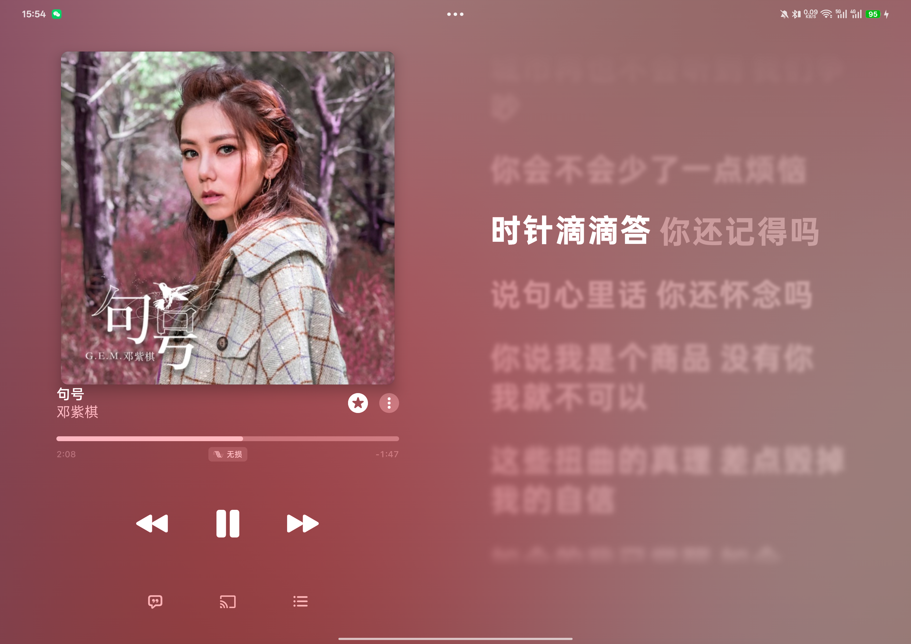
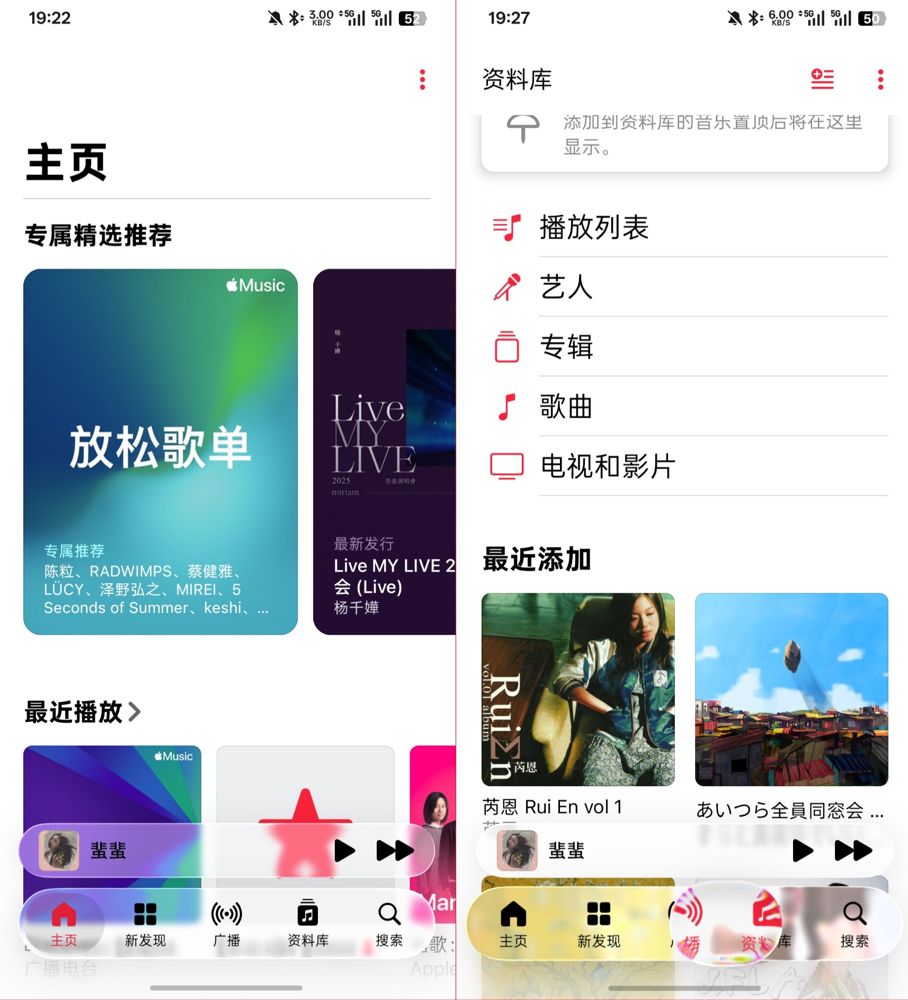

<a id="top"></a>

<p align="center">
  
</p>

<h1 align="center">AM++</h1>

<p align="center">
  <a href="README.md">简体中文</a> | English
</p>

<p align="center">
  Apple Music enhancements for Android: a tablet dual-pane player, lyric blur and fonts, custom lyrics, song title correction, and Liquid Glass navigation.
</p>

<p align="center">
  <a href="https://github.com/Zennmn/AM-plus-plus/actions/workflows/build.yml"></a>
  <a href="https://github.com/Zennmn/AM-plus-plus/blob/main/LICENSE"></a>
  
  
</p>

<p align="center">
  Without LSPosed, you can install the <a href="https://github.com/Zennmn/AM-plus-plus/releases/tag/embedded-2026.08.10-r1">npatch embedded edition</a> directly.
</p>

<details>
<summary>Contents</summary>

1. [Overview](#overview)
2. [Features](#features)
3. [Screenshots](#screenshots)
4. [Installation](#installation)
5. [Usage](#usage)
6. [Building from source](#building-from-source)
7. [Project structure](#project-structure)
8. [Roadmap](#roadmap)
9. [Contributing](#contributing)
10. [Privacy and permissions](#privacy-and-permissions)
11. [License and acknowledgments](#license-and-acknowledgments)

</details>

## Overview

The settings page is embedded in Apple Music's own settings list, under **AM++ Module Settings**. The module has no separate launcher icon.

Plugins can be imported and managed as ZIP packages. See the [plugin development guide](docs/plugin-development.md) for developer documentation.

## Features

| Feature | Default | Description |
| --- | --- | --- |
| Tablet dual-pane player | On | Shows the player on the left and live lyrics on the right in tablet landscape mode, while also suppressing Editorial Video. |
| Show cellular data settings | Off | Preserves the native data settings group and restores the availability checks for cellular usage preferences on Apple Music 6.5.2/1586, 6.5.3/1599, and 7.0.0-beta builds 1606/1607/1609/1611 on the development branch. Independent of dual-pane mode and song title correction. Restart Apple Music to show the entry. |
| Bidirectional lyric blur | On | Keeps the highlighted line clear and gradually blurs earlier and later lines according to their distance. Pauses during manual scrolling and resumes about one second after scrolling stops. Requires Android 12 or later. |
| CJK long-tail lyric animation | On | Reuses Apple Music's native rush-gradient animation for Chinese, Japanese, and Korean lyrics. Requires restarting Apple Music. |
| Lyric blur radius offset | `0px` | Adjusts the base blur radius by `-10..10px`. |
| Song title correction | Off | Rewrites displayed song titles and metadata using the selected region. Modes: original song region, fixed Mainland China, or fixed Japan. Requires restarting Apple Music. |
| Custom lyrics | Off | Injects TTML by Apple Music ID. Supports manual TTML, imports from AMLL, AM-Lyrics, and Lunabeat, and ZIP backup and restore. |
| Automatic live completion | On | When custom lyrics are enabled, automatically searches lyric services for songs with missing lyrics, missing word timing, or missing translations. |
| Lyric font | Off | Imports TTF/OTF fonts for player lyrics, with an option to restore the original font. |
| Liquid Glass navigation | Off | Requires Android 13 or later. Apple Music 6.5.2/6.5.3 retains the existing glass layout for phones and tablets in landscape dual-pane mode. The development branch's 7.0.0-beta builds 1606/1607/1609/1611 use the new phone bottom navigation or tablet top navigation with a separate mini player, supporting both single-pane and dual-pane layouts. Device validation is pending; see the [feature preservation and acceptance matrix](docs/feature-preservation.md). |
| Bottom bar height | `16dp` | Additional Liquid Glass setting for 6.5.x: the distance from the bar to the bottom of the screen, `0..48dp`. Requires restarting Apple Music. Version 7.0 uses the native navigation and mini-player bounds; this legacy geometry setting does not change the new layout. |
| Bottom bar background blur | `4dp` | Additional Liquid Glass setting: the background blur radius for the bar and mini player, `0..24dp`. Visible and effective only while Liquid Glass navigation is enabled. Requires restarting Apple Music. |
| Collapse on scroll | On | Available only on profiled 7.0.0-beta phones (1606/1607/1609); disabled on tablets and older versions. Scrolling down shrinks the capsule and narrows the mini player into the same row, with search detaching to the end. Scrolling up or selecting a tab expands it. Search stays in the capsule when it cannot detach; an absent mini leaves the middle empty. Applied live; no restart needed. |
| Tablet bottom bar compensation | Off | Compatibility option for an incorrectly displayed tablet bottom bar. When Liquid Glass is enabled, it controls the bar geometry, so this option is inactive and its settings row is hidden. |
| Apple Music internal DPI | Follow system | Changes resource density only within the Apple Music process. Range: `160..640`; `0` follows the system. Requires fully restarting Apple Music. |

## Screenshots

### Custom lyric injection

<p align="center">
  
  
</p>

### MiSans font replacement

<p align="center">
  
</p>

### Tablet dual-pane player and lyric blur

<p align="center">
  
</p>

### Liquid Glass navigation

<p align="center">
  
</p>

## Installation

### Xposed module (recommended)

Prerequisites: Apple Music and an Xposed framework supporting libxposed API 102. Check the API version reported by the framework core to determine compatibility; the Manager app version alone is insufficient.

1. Download and install the AM++ APK from [Releases](https://github.com/Zennmn/AM-plus-plus/releases/latest).
2. Enable **AM++** in LSPosed or a compatible Xposed manager.
3. Select only Apple Music (`com.apple.android.music`) in the module scope.
4. Force stop and reopen Apple Music.
5. Open Apple Music → Settings → **AM++ Module Settings**.

### npatch embedded edition

If you do not have LSPosed, you can use the [npatch embedded edition](https://github.com/Zennmn/AM-plus-plus/releases/tag/embedded-2026.08.10-r1). It cannot be installed alongside the official Apple Music app.

## Usage

See the [feature table](#features) above for individual switches. The following sections cover workflows that require multiple steps.

### Custom lyrics

1. Open **Custom Lyrics** in the module settings and enable custom lyric replacement.
2. Tap **Get ID** to read the Apple Music ID, title, and artist of the currently playing song, or enter the ID manually.
3. Choose a lyric source: paste or import a local TTML file, or import from AMLL, AM-Lyrics, or Lunabeat using the Apple Music ID.
4. Save the mapping and enable it for the song.
5. Force stop and reopen Apple Music.

Custom lyrics can be edited, deleted, and searched by name or Apple Music ID. ZIP backup and restore are also supported; when restoring, you can overwrite conflicting entries or keep the current versions. Invalid TTML is rejected, leaving Apple Music's original lyrics in use. TTML retrieved from AMLL is converted to Apple Music's format before being placed in the editor.

AMLL conversion orders lyric lines, translations, and romanization by each line's start time. Translations with matching starts are deduplicated in their original order and joined with newlines, even when their end times differ. Lyric voices and romanization remain separate; the combined translation belongs to the first line in the group, with space placeholders for the others to preserve alignment. Online updates and automatic live completion use the same conversion rules.

For manually authored TTML, see the [Apple Music TTML format guide](docs/apple-music-ttml-format.md).

With automatic live completion enabled, candidate lyrics are requested during playback only when the native lyrics are missing, lack word timing, or have word timing in a foreign language without a translation, and no usable manual lyrics are available. Disabling it stops these requests during playback. Manual imports are always initiated by the user.

Lunabeat caches its manifest and song index, downloading them again only when the remote revision changes.

### Lyric font

1. Select a TTF or OTF file under **Lyric Font** in the module settings.
2. Wait for the import to finish, then force stop and reopen Apple Music.
3. To revert, tap **Restore Original Font** and reopen Apple Music.

The font override applies only to player lyrics. It does not change system fonts or settings page fonts.

### Liquid Glass navigation

Enable Liquid Glass navigation, then force stop and reopen Apple Music. For the 6.5.x layout, it applies to phones and tablets in landscape with the tablet dual-pane player enabled; tablets in portrait or with dual-pane mode disabled retain the native interface. On tablets, the navigation bar and mini player sit side by side in one bottom capsule row, with navigation on the left and the mini player on the right, centered vertically at the same height. The row occupies about two-thirds of the screen width, with equal margins on both sides. Opening the player expands the lower-right capsule into a full-screen view by interpolating all four edges.

The navigation bar uses AndroidLiquidGlass's `LiquidBottomTabs`, and the mini player uses the `LiquidButton` material and press deformation. Playback controls retain their native implementation. Page backgrounds are sampled through a shared hardware `RenderNode`. See the [host adaptation guide](docs/host-adaptation-guide.md) for integration and maintenance details. The development branch's 7.0 layout is described in the [feature table](#features).

When Liquid Glass is enabled, two additional settings are available: **Bottom Bar Height** (`0..48dp`, the distance from the bar to the bottom of the screen, also adjusting bottom content padding and the player's peek height) and **Bottom Bar Background Blur** (`0..24dp`, applied to both the bar panel and mini player). These settings are hidden and inactive when Liquid Glass is disabled, and both require restarting Apple Music. The legacy height setting applies to 6.5.x as noted above. Each setting has a small reset button in its upper-right corner to restore its default independently (`16dp` / `4dp`).

A third add-on, **Collapse on scroll**, is available only on profiled 7.0.0-beta phones (1606/1607/1609). Tablets and older versions keep the expanded bar and hide its settings. This add-on is on by default and applies live with no restart: scrolling down more than 6dp shrinks the capsule to 43dp, showing the selected tab's glyph, narrows the mini player into the same row, and detaches search to the row's end. Scrolling up, selecting a tab or rotating expands it again. Search detaches continuously with the spring and only accepts taps once visible and interactive. Bottom content padding and the player's peek height follow the occupied height. When search cannot detach, the bar collapses as one capsule. It also collapses when the mini player is absent, leaving the middle empty by design.

The scroll signal has two sources: native containers expose their actual scroll offset, while Compose pages such as Library, New and parts of Search use gestures observed at the page root. A finger travelling up means the page is scrolling down. Both sources share gesture-origin ownership, with native fling observation continuing after a page gesture ends. Gestures starting in the navigation interaction band or mini player never drive collapse, even after the finger leaves that region. Observation never consumes or rewrites events, and predominantly horizontal page swipes do not trigger collapse.

Pulling farther outward at the page's top or bottom does not collapse or expand the bar. The page must be able to scroll in the requested direction; moving back into its content still works. Empty pages and content shorter than the viewport do not change the bar from finger movement alone.

### Song title correction

Enable song title correction, choose a mode, and reopen Apple Music. When disabled, metadata follows the Apple Music account region. When enabled, the module resolves metadata for the selected region and caches the results.

## Building from source

Requirements: JDK 17, Android SDK 37, Android Build Tools 37.0.0, and the bundled Gradle Wrapper. The project is written in Kotlin and built with Android Gradle Plugin. Module loading and cross-process configuration use the libxposed API and service.

Windows:

```powershell
.\gradlew.bat test :app:lintDebug :app:lintVitalRelease :app:assembleRelease
```

Linux or macOS:

```bash
chmod +x gradlew
./gradlew test :app:lintDebug :app:lintVitalRelease :app:assembleRelease
```

CI also checks the glass renderer source and runs Lint on `glass`. Pull request builds use `assembleDebug` instead of `assembleRelease`.

The release APK is generated at:

```text
app/build/outputs/apk/release/app-release.apk
```

To build a signed release APK, copy `keystore.properties.example` to the Git-ignored `keystore.properties` and fill in the keystore path, passwords, and alias. Environment variables such as `AMPP_RELEASE_STORE_FILE` can override these values. Debug APKs can still be built without a release signing configuration.

## Project structure

```text
app/src/main/java/        Module entry point, dependency assembly, settings, feature orchestration, and Android storage
app/src/main/resources/   libxposed module metadata
core/                    Configuration and lyric logic, network sources, caching, and layout policies
host-api/                Semantic host capabilities, events, installation results, and subscriptions
hook-runtime/            libxposed wrappers, registration scopes, and logging
host-applemusic/          Version profiles, reflection/DexKit resolution, and native host integration
glass/                   AndroidLiquidGlass renderer, vendored at a pinned commit
backdrop/                Upstream Backdrop library
docs/                    Adaptation and feature documentation
scripts/                 Optional device regression, recording analysis, and host profile validation scripts
```

## Roadmap

- [x] Tablet landscape dual-pane player
- [x] Bidirectional lyric blur
- [x] Custom lyric injection, backup, and restore
- [x] Lyric font import and restore
- [x] Liquid Glass navigation and mini player (phones; device validation pending for tablets in landscape with dual-pane mode enabled)
- [x] Song title correction
- [ ] Continue adapting to future Apple Music versions

## Contributing

Issues and pull requests are welcome. For code changes, run at least `test`, `lintVitalRelease`, and `assembleRelease`. For changes affecting interface behavior, include your device model, Android version, Apple Music version, and screenshots or a recording in the issue or pull request. Read the [host adaptation guide](docs/host-adaptation-guide.md) before adapting a new Apple Music version. See the [documentation index](docs/README.md) for the full documentation.

## Privacy and permissions

- The module declares only the `INTERNET` permission, used for user-initiated lyric imports from AMLL, AM-Lyrics, and Lunabeat in the settings page, and eligible lyric requests during playback when automatic live completion is enabled.
- It requests no storage or notification runtime permissions. Local files are read through the Android file picker.
- The module includes no analytics service or separate entry Activity.
- Before the initial migration, configuration comes from Xposed remote preferences and remote files. After migration, ordinary settings, the lyric index, and font files are stored in Apple Music's private host directory.

## License and acknowledgments

This project is open source under the [GNU General Public License v3.0](LICENSE). Third-party code and dependencies remain subject to their original licenses. See [THIRD_PARTY_NOTICES.md](THIRD_PARTY_NOTICES.md) for details.

- [AMLyricBlur](https://github.com/a23bc/amlyricblur): source of the ported bidirectional lyric blur core.
- [AndroidLiquidGlass / Backdrop](https://github.com/Kyant0/AndroidLiquidGlass): glass refraction, highlights, dispersion, and reference interactions.

<p align="right">(<a href="#top">Back to top</a>)</p>
